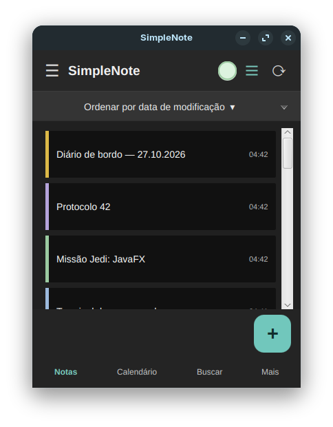
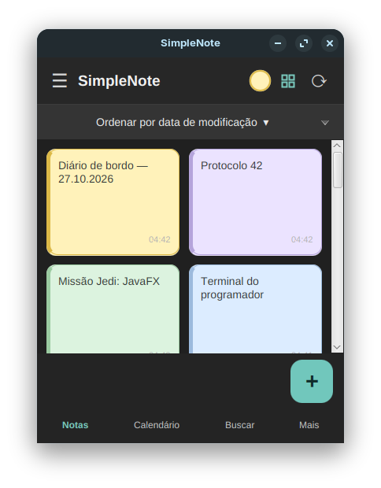
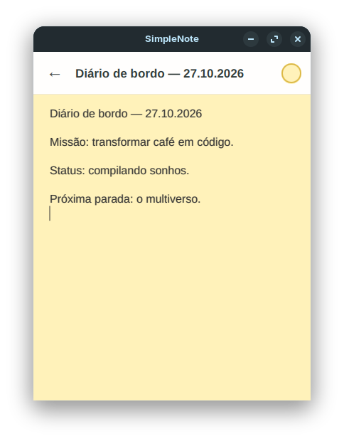
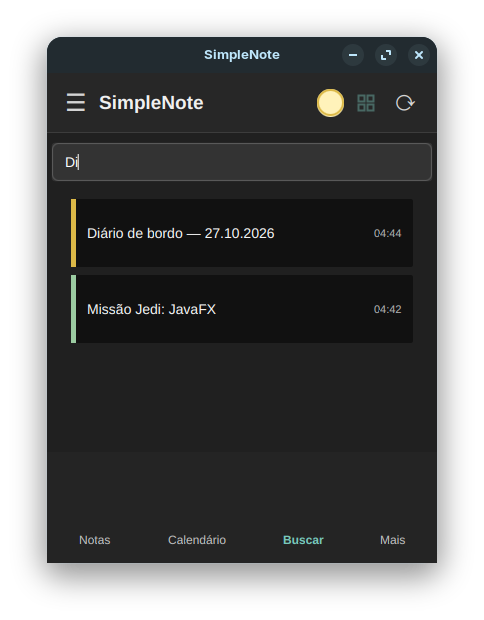
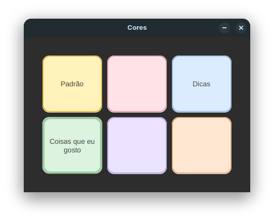
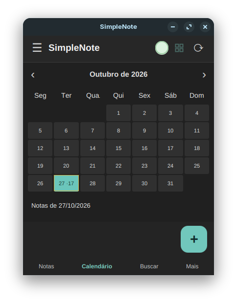

# SimpleNote — JavaFX

Aplicativo desktop de anotações desenvolvido em **Java e JavaFX**, com interface inspirada na praticidade de aplicativos de notas, como o ColorNote.

O projeto começou como um exercício de aprendizado e evoluiu para uma aplicação funcional de portfólio, com organização de notas, personalização visual e persistência de dados.

## Capturas de tela

| Lista de notas | Visualização em grade |
|:---:|:---:|
|  |  |

| Editor | Pesquisa |
|:---:|:---:|
|  |  |

| Cores | Calendário |
|:---:|:---:|
|  |  |

## Funcionalidades implementadas

- Criar e editar anotações sem campo obrigatório de título.
- Exibir prévia das notas e data da última alteração.
- Alternar entre visualização em lista e grade.
- Pesquisar notas pelo conteúdo ou pelo título.
- Organizar visualmente as notas com cores personalizáveis.
- Consultar as notas por data na visualização de calendário.
- Editar o título de uma nota separadamente do conteúdo.
- Salvar alterações localmente e sincronizar com o banco de dados MariaDB.
- Navegação por teclado em partes da interface.

## Tecnologias

- **Java 25**
- **JavaFX 25** (FXML e CSS)
- **Maven**
- **MariaDB / MySQL**
- **SQLite** para cache local

## Executar em desenvolvimento

**Pré-requisitos:** JDK 25, Maven e servidor MariaDB/MySQL configurado para o projeto.

```bash
mvn clean javafx:run
```

Os scripts de banco utilizados durante o desenvolvimento estão em [`scripts/`](scripts/). O arquivo `simplenote_backup.sql` contém a estrutura e dados de demonstração do ambiente local; revise-o antes de importá-lo em outro banco.

A configuração de conexão do banco é local e **não deve ser versionada com senhas**.

## Situação do projeto

**Versão de demonstração para portfólio.** As funcionalidades principais estão disponíveis, mas a versão ainda está passando por revisão visual, testes completos e preparação para distribuição Windows. Não é uma versão comercial finalizada.

## Autor

Desenvolvido por **Axel Castro — devaxl64**.

[GitHub](https://github.com/devaxl64)
